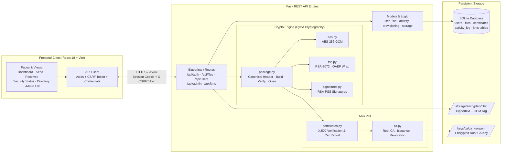
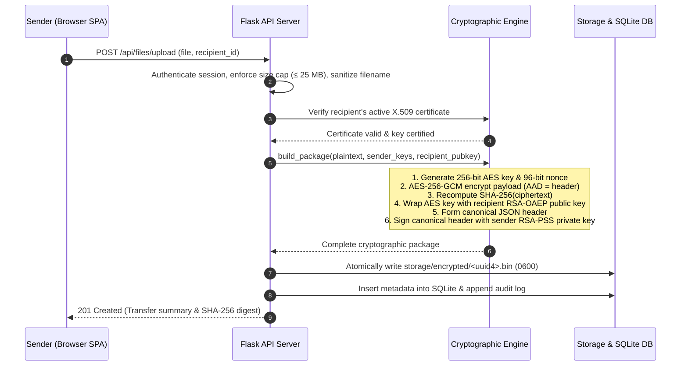
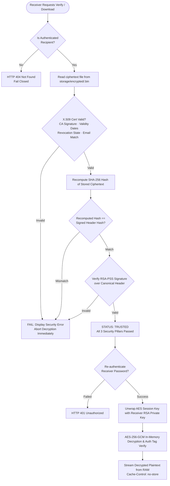
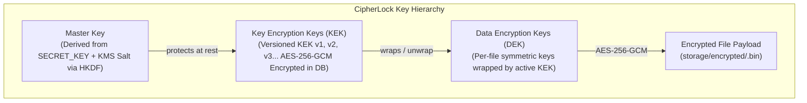

# CipherLock — Secure File Storage & Sharing System

**Applied Cryptography and Network Security** · SPIT Mumbai

CipherLock is an applied cryptographic web platform that allows registered users to securely store and share sensitive files with end-to-end mathematical guarantees:
- **Confidentiality:** Files are encrypted using authenticated symmetric cipher **AES-256-GCM**.
- **Key Protection:** Ephemeral 256-bit AES session keys are wrapped for the recipient using **RSA-OAEP** (SHA-256, MGF1).
- **Integrity & Non-Repudiation:** Package metadata and ciphertext hashes are digitally signed with the sender's private key using **RSA-PSS** (SHA-256, 32-byte salt).
- **Sender Authentication & Trust:** Backed by an internal Mini Public Key Infrastructure (**Root CA**) that issues and validates **X.509 certificates**.
- **Strict Fail-Closed Verification:** Before any file is decrypted, the receiver's pipeline verifies the X.509 certificate chain, recomputes the ciphertext SHA-256 hash directly from disk, and verifies the digital signature. If any check fails, decryption is refused and plaintext is never produced.
- **Memory-Buffered Architecture:** Plaintext never touches the server filesystem or temporary directories; file parts are streamed into memory (`io.BytesIO`) and decrypted streams are served with `Cache-Control: no-store`.

---

## Table of Contents
1. [Core Features](#core-features)
2. [Cryptographic Design Principles (D1–D8)](#cryptographic-design-principles-d1d8)
3. [System Architecture](#system-architecture)
   - [System Overview](#system-overview)
   - [Sender Upload Pipeline](#sender-upload-pipeline)
   - [Receiver Verification & Decryption Pipeline](#receiver-verification--decryption-pipeline)
   - [Key Management Hierarchy (KMS)](#key-management-hierarchy-kms)
4. [Technology Stack](#technology-stack)
5. [Installation & Setup](#installation--setup)
   - [Prerequisites](#prerequisites)
   - [Quick Start (One-Command Setup)](#quick-start-one-command-setup)
   - [Manual Setup (Step-by-Step)](#manual-setup-step-by-step)
6. [Running the Application](#running-the-application)
7. [Testing & Verification](#testing--verification)
   - [Running Pytest Suite](#running-pytest-suite)
   - [Running E2E CLI Attack Suite](#running-e2e-cli-attack-suite)
   - [Interactive CLI Attack Demonstrations](#interactive-cli-attack-demonstrations)
8. [Project Structure](#project-structure)
9. [API Reference](#api-reference)

---

## Core Features

- **Hybrid Encryption Engine:** Combines the speed of AES-256-GCM for arbitrary-sized payloads with the asymmetric security of RSA-3072 for key encapsulation and digital signatures.
- **Built-in Mini PKI:** A self-signed RSA-4096 Root CA generates and manages one-year X.509 certificates for users, tracking serial numbers, subject identities, validity periods, and real-time database revocation states.
- **Fail-Closed Security Verification:** The receiver pipeline executes certificate chain validation, re-hashes the stored `.bin` payload to compare against the canonical JSON header, and checks the RSA-PSS signature. Any tampering causes immediate abort with safe, generic error reporting.
- **Protected Private Keys at Rest:** User private keys are protected as encrypted PKCS#8 envelopes using HKDF-SHA256 derived keys from the application secret and bound to the user ID. Account password re-authentication is enforced during download to unlock the private key transiently in-memory.
- **Memory-Buffered Processing:** Werkzeug's stream factory is overridden (`InMemoryUploadRequest`) to prevent multipart uploads from spooling to `/tmp`. Plaintext is encrypted before touching disk, and decrypted bytes stream directly from RAM.
- **Interactive Security Status & Audit Terminal:** The frontend features a comprehensive security dashboard presenting 3 dedicated verification panels (Certificate, Signature, Integrity) alongside a live ASCII audit check box replicating terminal diagnostics.
- **Interactive Attacker Simulation Lab (`DEMO_MODE=1`):** An administrative suite allows simulated attacks against local test packages—such as flipping ciphertext bits, altering metadata, corrupting signatures, or swapping rogue certificates—to demonstrate live detection and fail-closed prevention with one-click restore.
- **Key Management System (KMS):** Advanced multi-tier key lifecycle management featuring versioned Key Encryption Keys (KEKs), automated rotation policies, compromise detection, and non-disruptive DEK rewrapping.
- **Hardened Authentication:** Passwords hashed with salted `scrypt`, thread-safe brute-force lockout (5 attempts per email/IP triggers a 300-second lockout), timing-safe dummy verifications for nonexistent accounts, and CSRF token enforcement.

---

## Cryptographic Design Principles (D1–D8)

CipherLock strictly complies with eight foundational design rules:

| Rule | Title | Cryptographic Specification |
|:---:|:---|:---|
| **D1** | **Hybrid Encryption** | **AES-256-GCM** encrypts file payloads. **RSA-OAEP** (SHA-256, MGF1-SHA-256) wraps the 32-byte AES key. **RSA-PSS** (SHA-256, salt length 32) signs the canonical header. RSA never directly encrypts files. |
| **D2** | **Dedicated Key Pairs** | Each user possesses a single **RSA-3072** key pair. X.509 `KeyUsage` strictly enforces `digitalSignature` and `keyEncipherment`. |
| **D3** | **Key Protection at Rest** | User private keys are stored exclusively as encrypted PKCS#8 envelopes using AES-256-GCM and HKDF-SHA256 bound to user ID. Private keys are never logged, stored in sessions/cookies, or transmitted to browsers. |
| **D4** | **Mini Public Key Infrastructure** | A self-signed **RSA-4096** Root CA (10-year validity) issues 1-year X.509 end-entity certificates. Real-time revocation is enforced at the database level. |
| **D5** | **Fresh Session Keys & Nonces** | Every upload generates a cryptographically random 32-byte AES key and 12-byte CSPRNG nonce (`os.urandom`). Stored format: `ciphertext \|\| 16-byte GCM tag`. Canonical header is authenticated as AAD. |
| **D6** | **Canonical Signed Header** | Deterministic UTF-8 JSON with sorted keys and no whitespace: `{"ciphertext_sha256_hex":..., "nonce_b64":..., "original_filename":..., "receiver_id":..., "sender_cert_serial":..., "sender_id":..., "version":1, "wrapped_key_b64":...}`. Ciphertext hash is **recomputed from disk bytes**, never trusted from database fields. |
| **D7** | **Fail-Closed Verification** | Recipient pipeline enforces: Authorization $\rightarrow$ X.509 Validity & Revocation $\rightarrow$ Recomputed SHA-256 Integrity $\rightarrow$ RSA-PSS Signature $\rightarrow$ RSA-OAEP Unwrap $\rightarrow$ AES-GCM Decrypt. Any failure halts execution and forbids decryption. |
| **D8** | **Storage & Memory Discipline** | Max 25 MB file size. Plaintext **never touches server disk or temporary files**. Ciphertext is stored as `<uuid4>.bin` with restrictive permissions (`0600`). Decrypted plaintext is streamed in-memory with `Cache-Control: no-store`. |

---

## System Architecture

### System Overview



### Sender Upload Pipeline



### Receiver Verification & Decryption Pipeline



### Key Management Hierarchy (KMS)



---

## Technology Stack

| Layer | Component | Version / Library | Purpose |
|:---|:---|:---|:---|
| **Frontend Framework** | React | `18.3.1` | Single-page reactive user interface |
| **Frontend Tooling** | Vite | `5.4.11` | Build pipeline and development proxy server |
| **Styling & CSS** | Tailwind CSS | `3.4.15` | Modern design system, responsive layouts, micro-animations |
| **Icons & Notifications** | Lucide React / Hot Toast | `lucide-react`, `react-hot-toast` | UI icons and asynchronous toast notifications |
| **HTTP Client** | Axios | `1.7.9` | Asynchronous REST requests with automated CSRF injection |
| **Backend Framework** | Flask | `3.1.3` | Lightweight REST API server and error routing |
| **Cryptography** | PyCA Cryptography | `46.0.3` | Production-grade primitives (AES-GCM, RSA-OAEP, RSA-PSS, X.509) |
| **CSRF Defense** | Flask-WTF | `1.2.2` | Synchronizer token pattern across all mutating endpoints |
| **Password Hashing** | Werkzeug | `3.1.3` | Salted `scrypt` hashing and timing-safe verification |
| **Database** | SQLite 3 | Standard Library | Parameterized SQL storage with additive migrations |
| **Configuration** | Python-Dotenv | `1.0.1` | Environment variable management (`.env`) |
| **Testing** | Pytest | `8.4.2` | Unit, integration, and security test execution |

---

## Installation & Setup

### Prerequisites

- **Python:** Version `3.11` or higher (`python --version`)
- **Node.js:** Version `18.0` or higher (`node --version`)
- **Package Manager:** `npm` (`npm --version`)

---

### Quick Start (One-Command Setup)

CipherLock provides an automated setup script that creates `.env`, generates cryptographically strong passphrases, creates the database tables, and initializes the Root CA:

```powershell
# 1. Install backend dependencies
pip install -r requirements.txt

# 2. Run automated developer setup
python scripts/setup_dev.py
```

To clean and reset the local database, CA, and stored files at any time:
```powershell
python scripts/setup_dev.py --reset
```

---

### Manual Setup (Step-by-Step)

#### 1. Configure Environment Variables
Copy `.env.example` to `.env`:

```powershell
# Windows PowerShell
Copy-Item .env.example .env

# Linux / macOS
cp .env.example .env
```

Ensure `.env` contains:
```ini
# Flask secret key (>= 32 chars; protects private key envelopes at rest)
SECRET_KEY=461fd176af921a15738be1efe29ab9a115732eaa9ab80ef3202e69a63bb749d2

# Root CA key passphrase (>= 16 chars; unlocks keys/ca/ca_key.pem)
CIPHERLOCK_CA_PASSPHRASE=YourSecureCAPassphraseHere123!

# Demo Mode (1 = enable attack lab & simulation endpoints, 0 = production safe)
DEMO_MODE=1

# Session security
SESSION_COOKIE_SECURE=0
FRONTEND_URL=http://localhost:5173
```

#### 2. Backend Setup

```powershell
# Create and activate Python virtual environment
python -m venv .venv
.\.venv\Scripts\Activate.ps1   # On Linux/macOS: source .venv/bin/activate

# Install Python dependencies
pip install -r requirements.txt

# Verify environment configuration
python scripts/check_env.py

# Initialize database schema and migrations
python init_db.py

# Bootstrap the Root Certificate Authority
python scripts/init_ca.py

# Create an administrator account
python scripts/create_admin.py
```

#### 3. Frontend Setup

```powershell
cd frontend
npm install
npm run build    # Verify production build compilation
cd ..
```

---

## Running the Application

CipherLock runs with the Flask JSON API backend and the React Vite SPA concurrently:

### Terminal 1: Backend Server (Flask API)
```powershell
python run.py
# Running on http://127.0.0.1:5000 (Health endpoint: http://127.0.0.1:5000/health)
```

### Terminal 2: Frontend Client (Vite Dev Server)
```powershell
cd frontend
npm run dev
# Running on http://localhost:5173 (Proxies /api requests to port 5000)
```

Visit **[http://localhost:5173](http://localhost:5173)** in your browser.

> **Testing Tip:** Open a normal browser window to log in as sender (e.g. `siddharth@example.com`) and an incognito/private window to log in as receiver (e.g. `vidhi@example.com`).

---

## Testing & Verification

### Running Pytest Suite
Execute the full test suite covering all security, crypto, auth, storage, and KMS modules:

```powershell
python -m pytest -v
```

*Expected Result:* **213 passed, 2 skipped** (Windows POSIX permissions and symlink tests skipped appropriately on Windows).

### Running E2E CLI Attack Suite
Validate the complete hybrid package engine against 9 attack vectors without requiring the web UI:

```powershell
python scripts/e2e_cli.py
```

*Expected Output:*
```text
--------------------------------
CIPHERLOCK SECURITY CHECK
--------------------------------
Certificate: VALID
Signature: VALID
Integrity: PASSED
Status: TRUSTED
--------------------------------
Attack-case results:
1. Ciphertext byte flip         POSSIBLE TAMPERING [PASS]
2. Filename changed             POSSIBLE TAMPERING [PASS]
3. Receiver ID changed          POSSIBLE TAMPERING [PASS]
4. Signature from another user  POSSIBLE TAMPERING [PASS]
5. Rogue CA certificate         UNTRUSTED SENDER   [PASS]
6. Expired sender certificate   UNTRUSTED SENDER   [PASS]
7. Revoked sender certificate   UNTRUSTED SENDER   [PASS]
8. Wrong recipient key          UNWRAP REJECTED    [PASS]
9. Attacker without private key NO PRIVATE KEY     [PASS]

Result: PASS — 9/9 attack cases matched.
```

### Interactive CLI Attack Demonstrations
Verify security boundaries with isolated local demonstration scripts:

```powershell
# 1. Reversible local ciphertext, metadata, and signature tampering
python scripts/demo_tamper.py

# 2. Authorization boundary and privilege separation tests (7 cases)
python scripts/demo_unauthorized.py

# 3. Dynamic certificate revocation and verification change tests
python scripts/demo_revocation.py

# 4. RSA-OAEP session-key wrapping and RSA-PSS signature randomization
python scripts/demo_wrap_sign.py
```

---

## Project Structure

```text
CipherLock/
├── app.py                     # Flask application factory, CSRF, error handlers, memory streamer
├── config.py                  # Central configuration, file size limits, environment loader
├── init_db.py                 # SQLite database initialization & migrations
├── run.py                     # Local development entrypoint
├── requirements.txt           # Python backend dependencies
├── .env.example               # Environment variables template
├── .gitignore                 # Secrets, keys, certificates, binaries, and build artifacts
│
├── crypto/                    # Cryptographic Primitives & Engines (PyCA)
│   ├── aes.py                 # AES-256-GCM authenticated encryption/decryption
│   ├── rsa.py                 # RSA-3072 keygen, PEM serialization, RSA-OAEP wrapping
│   ├── signatures.py          # RSA-PSS digital signatures (SHA-256, 32-byte salt)
│   ├── ca.py                  # Self-signed RSA-4096 Root CA, user cert issuance, revocation
│   ├── certificates.py        # X.509 certificate validation and CertReport generation
│   ├── package.py             # Canonical header, hybrid package builder, verify, open
│   ├── key_storage.py         # Encrypted private key envelopes bound to user ID
│   └── kms.py                 # KMS envelope encryption and key rotation logic
│
├── models/                    # Data Access & Domain Logic
│   ├── user.py                # User CRUD, scrypt password hashing, timing-safe lookup
│   ├── file.py                # File metadata records, status transitions, package reconstruction
│   ├── activity.py            # Security audit logging with throttling
│   ├── lockout.py             # In-memory IP/email brute-force lockout manager
│   ├── provisioning.py        # Transactional user keypair and X.509 cert provisioning
│   ├── storage.py             # Restrictive UUID ciphertext storage (0600)
│   └── kms.py                 # KMS service, KEK versioning, rotation policies, and rewrap
│
├── routes/                    # API Endpoints & Route Handlers
│   ├── __init__.py            # Authentication & admin decorators (@login_required, @admin_required)
│   ├── auth.py                # Account registration, login, logout, me, activity
│   ├── files.py               # File upload, listings, verification, and streaming download
│   ├── users.py               # Certificate trust directory and certificate viewer
│   ├── admin.py               # CA statistics, certificate management, Attack Lab endpoints
│   └── kms.py                 # KMS status, rotation, compromise, recovery, and rewrapping
│
├── database/                  # Relational Storage (SQLite)
│   ├── db.py                  # Database connection helpers and table migration runner
│   ├── schema.sql             # Relational schema (users, files, certificates, activity_log)
│   └── schema_kms.sql         # KMS schema (kek_versions, dek_registry, kms_audit_log, policies)
│
├── frontend/                  # React 18 + Vite + Tailwind CSS Single-Page Application
│   ├── package.json           # Frontend dependencies and npm scripts
│   ├── vite.config.js         # Vite configuration and backend API proxy (/api -> :5000)
│   ├── tailwind.config.js     # Tailwind CSS theme, colors (navy, lime, paper), shadows
│   ├── src/
│   │   ├── main.jsx           # React application mounting
│   │   ├── App.jsx            # React Router routing table & route guards
│   │   ├── index.css          # Design system styles, surfaces, buttons, and animations
│   │   ├── api/client.js      # Axios instance with CSRF header extraction and retry
│   │   ├── context/           # AuthContext managing user session state
│   │   ├── components/        # Reusable UI components (Navbar, SecurityPanel, SecurityBox)
│   │   └── pages/             # Application views (Dashboard, Send, Received, SecurityStatus)
│
├── templates/                 # Server-rendered Jinja2 templates (Landing, KMS Dashboard)
├── static/                    # Static assets (CSS, JS)
├── scripts/                   # Utility & Verification Scripts
│   ├── setup_dev.py           # Automated developer environment bootstrapper
│   ├── check_env.py           # Environment sanity and version validator
│   ├── init_ca.py             # Root CA manual initializer
│   ├── create_admin.py        # Administrative account generator
│   ├── e2e_cli.py             # 9-scenario cryptographic attack test runner
│   ├── demo_tamper.py         # Reversible ciphertext/metadata tampering demonstration
│   ├── demo_unauthorized.py   # Authorization boundary checks
│   ├── demo_revocation.py     # Certificate revocation demonstration
│   └── demo_wrap_sign.py      # RSA-OAEP and RSA-PSS primitive demonstration
│
└── tests/                     # Automated Pytest Suite (213 tests)
    ├── test_app.py            # App factory and health check tests
    ├── test_auth.py           # Authentication, scrypt, and lockout tests
    ├── test_crypto.py         # AES-GCM and RSA primitive tests
    ├── test_ca_certs.py       # Root CA and X.509 certificate validation tests
    ├── test_wrap.py           # RSA-OAEP key wrapping unit tests
    ├── test_signatures.py     # RSA-PSS digital signature unit tests
    ├── test_package.py        # Hybrid package engine and attack scenario tests
    ├── test_files.py          # Upload, memory streaming, and storage tests
    ├── test_flow.py           # End-to-end receiver verification and download tests
    ├── test_attacks.py        # Attack simulation lab and restore tests
    └── test_kms.py            # KMS key hierarchy and rotation tests
```

---

## API Reference

### Core JSON REST Endpoints

| Method | Endpoint | Description | Access Level | CSRF Protected |
|:---|:---|:---|:---:|:---:|
| `GET` | `/health` | Application health status (`{"status": "ok"}`) | Public | No |
| `GET` | `/api/csrf-token` | Fetch synchronizer CSRF token (`Cache-Control: no-store`) | Public | No |
| `POST` | `/api/auth/register` | Register user account with automatic RSA key & X.509 cert | Public | Yes |
| `POST` | `/api/auth/login` | Authenticate user session (enforces 5-attempt lockout) | Public | Yes |
| `POST` | `/api/auth/logout` | Terminate active user session and audit event | Authenticated | Yes |
| `GET` | `/api/auth/me` | Fetch active user profile and role | Authenticated | No |
| `GET` | `/api/users/directory` | Directory of active users with public keys and cert validity | Authenticated | No |
| `GET` | `/api/users/<id>/certificate` | Return public X.509 certificate in PEM format | Authenticated | No |
| `POST` | `/api/files/upload` | Multipart upload with hybrid encryption (AES-GCM + OAEP + PSS) | Authenticated | Yes |
| `GET` | `/api/files/sent` | List transfers sent by the current user (paginated) | Authenticated | No |
| `GET` | `/api/files/received` | List transfers received by current user with status | Authenticated | No |
| `GET` | `/api/files/<id>/verify` | Execute cryptographic verification pipeline; return `SecurityReport` | Recipient Only | No |
| `POST` | `/api/files/<id>/download` | Re-verify package, unlock private key with password, stream plaintext | Recipient Only | Yes |
| `GET` | `/api/admin/ca-info` | Fetch Root CA metadata and active/revoked statistics | Admin Only | No |
| `POST` | `/api/admin/certificates/<serial>/revoke` | Revoke a user certificate by serial number | Admin Only | Yes |
| `POST` | `/api/admin/lab/tamper-ciphertext` | Flip 1 byte of stored ciphertext (`DEMO_MODE=1` only) | Admin Only | Yes |
| `POST` | `/api/admin/lab/restore` | Restore original package from backup (`DEMO_MODE=1` only) | Admin Only | Yes |
| `GET` | `/api/kms/status` | Current KMS key hierarchy status and active KEK info | Authenticated | No |
| `POST` | `/api/kms/rotate` | Trigger manual KEK rotation and transition | Admin Only | Yes |
| `POST` | `/api/kms/rewrap` | Mass rewrap all DEKs under latest active KEK | Admin Only | Yes |

---

## License

Academic and educational project developed by team CipherLock for the **Cryptography and Network Security** curriculum at Sardar Patel Institute of Technology (SPIT), Mumbai.
