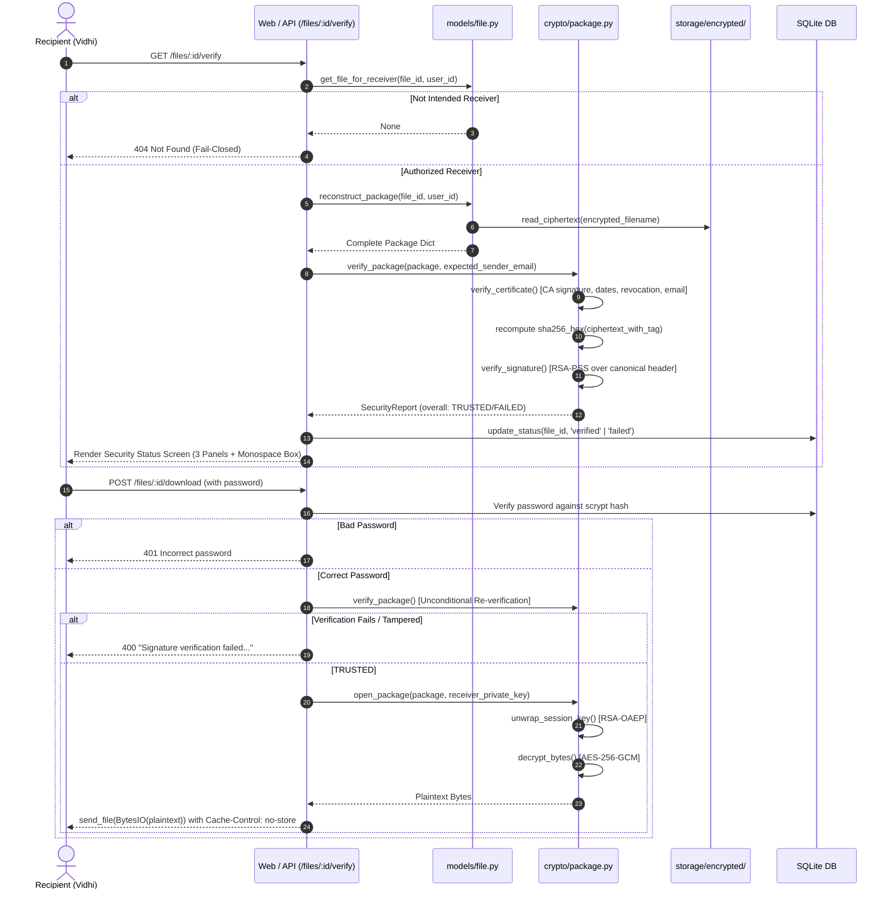

# CipherLock – System Architecture

> **Status:** Phase 8 Complete (Receiver Workflow, Security Status UI, and In-Memory Decryption)  
> **Last updated:** 2026-10-24  

This document describes the structural and cryptographic architecture of CipherLock.
CipherLock is a secure file storage and sharing web application designed with fail-closed security guarantees: confidentiality (AES-256-GCM), integrity and non-repudiation (RSA-PSS digital signatures over canonical JSON headers), sender authentication and authorization (X.509 PKI certificates issued by an internal Root CA), and recipient key protection (RSA-OAEP session-key wrapping).

```
Browser ──HTTP──► Flask app (app.py) ◄── Vite Proxy (/api) ◄── React SPA (frontend/)
                     │
                     ├── config.py             (Environment-backed settings, paths, limits)
                     ├── routes/auth.py        (/api/auth: register, login, logout, me, activity)
                     ├── routes/files.py       (/api/files + web: upload, sent, received, verify, download)
                     ├── routes/users.py       (/api/users: directory, certificate inspection)
                     ├── routes/admin.py       (/api/admin: CA info, certificate management, revocation)
                     ├── models/user.py        (scrypt hashing, user CRUD, password policy, envelope lookup)
                     ├── models/file.py        (transfer CRUD, status management, package reconstruction)
                     ├── models/activity.py    (audit trail with throttled read logging)
                     ├── models/lockout.py     (in-memory brute-force lockout: 5 failures / 300s)
                     ├── models/provisioning.py (atomic user keygen and X.509 cert issuance)
                     ├── models/storage.py     (safe UUID binary payload storage, O_EXCL, fsync)
                     ├── crypto/aes.py         (AES-256-GCM authenticated encryption/decryption)
                     ├── crypto/rsa.py         (RSA-3072 keygen, RSA-OAEP wrapping/unwrapping)
                     ├── crypto/signatures.py  (RSA-PSS SHA-256 signing/verification)
                     ├── crypto/ca.py          (Root CA generation, user certificate issuance, revocation)
                     ├── crypto/certificates.py(X.509 certificate validation and CertReport)
                     ├── crypto/package.py     (canonical JSON header, hybrid package build, verify, open)
                     ├── crypto/key_storage.py (AES-GCM user private-key envelope bound to user ID)
                     ├── database/db.py        (SQLite connection lifecycle, migrations)
                     ├── database/schema.sql   (users, files, certificates, activity_log)
                     ├── templates/            (Jinja2 templates: base, index, security_status, received_files, dashboard)
                     └── frontend/src/         (React 18 + Vite + Tailwind v3 SPA)
```

---

## Application Factory (`app.py`)

`app.py` uses the **Flask application factory pattern** (`create_app`), enhanced with an in-memory upload stream handler:

- **`InMemoryUploadRequest`**: Overrides Werkzeug's `_get_file_stream` to buffer multipart uploads directly into `io.BytesIO` up to `MAX_CONTENT_LENGTH` (25 MiB). This strictly enforces design decision **D8**: plaintext files are never written to `/tmp` or server disk.
- **Directory Initialization**: Automatically ensures `storage/encrypted/`, `certificates/ca/`, `certificates/users/`, `keys/ca/`, and `keys/users/` exist with appropriate permissions.
- **Database Initialization**: Runs idempotent schema creation and additive migrations (`migrate_files_table`).
- **CSRF Protection**: `CSRFProtect` active on all state-mutating requests, supported by `GET /api/csrf-token` with `Cache-Control: no-store`.
- **Blueprint Registration**: Registers `auth_bp`, `files_bp`, `files_web_bp`, `users_bp`, and `admin_bp`.
- **Scoped Error Handlers**: Returns JSON error shapes for `/api/*` requests while rendering friendly HTML error pages (`403.html`, `404.html`, `413.html`) for browser routes.

---

## Cryptographic Design Decisions (D1–D8)

CipherLock adheres to eight immutable cryptographic rules:

1. **D1 — Hybrid Encryption Standard**: AES-256-GCM encrypts files; RSA-OAEP (SHA-256, MGF1-SHA-256) wraps the AES key; RSA-PSS (SHA-256, 32-byte salt) signs the canonical package header. RSA never encrypts files directly.
2. **D2 — RSA Key Pairs**: Each user has one RSA-3072 key pair; X.509 `KeyUsage` = `digitalSignature` + `keyEncipherment`.
3. **D3 — Private Key Protection at Rest**: User private keys are protected as encrypted PKCS#8 envelopes using HKDF-SHA256 derived keys from Flask's `SECRET_KEY` and bound to the user ID. The user's account password re-authenticates the user prior to in-memory decryption. Keys are never logged, stored in sessions, or exposed via API.
4. **D4 — Mini Public Key Infrastructure (PKI)**: Self-signed Root CA (RSA-4096, 10-year validity, `BasicConstraints ca=True`, `KeyUsage keyCertSign+cRLSign`). User certificates are issued for 1 year with unique serial numbers, `CN=name`, `emailAddress=email`, SAN email, and database-tracked revocation status.
5. **D5 — AES-GCM File Encryption**: Fresh random 32-byte session key and random 12-byte nonce generated for every upload. Stored format = `ciphertext || 16-byte GCM tag`. Canonical header metadata is authenticated as Additional Authenticated Data (AAD).
6. **D6 — Canonical Signed Header**: JSON sorted keys, compact separators, UTF-8 encoded:
   `{"ciphertext_sha256_hex": "...", "nonce_b64": "...", "original_filename": "...", "receiver_id": ..., "sender_cert_serial": ..., "sender_id": ..., "version": 1, "wrapped_key_b64": "..."}`
   At verification, `ciphertext_sha256_hex` is **always recomputed from the disk file**, never trusted from database fields.
7. **D7 — Receiver Pipeline (Fail-Closed)**: 
   Authorization $\rightarrow$ X.509 Certificate Validation (CA signature, validity dates, revocation status, subject match) $\rightarrow$ RSA-PSS Signature Verification $\rightarrow$ **Only Then** RSA-OAEP Key Unwrap $\rightarrow$ AES-GCM In-Memory Decryption. If any step fails, return exact message:
   *"Signature verification failed. File may have been modified or sender authenticity could not be established."* and **never decrypt**.
8. **D8 — File Storage Constraints**: Max 25 MB per file, `secure_filename`, stored under random UUID `<uuid4>.bin` in `storage/encrypted/`. Plaintext is **never** written to disk.

---

## Database Layer (`database/`)

SQLite 3 with `PRAGMA foreign_keys = ON` manages application state across 4 tables:

```sql
-- Core schemas (database/schema.sql)
users (
    id INTEGER PRIMARY KEY AUTOINCREMENT,
    name TEXT NOT NULL,
    email TEXT NOT NULL COLLATE NOCASE UNIQUE,
    password_hash TEXT,
    public_key BLOB,
    encrypted_private_key BLOB,
    certificate BLOB,
    is_admin INTEGER NOT NULL DEFAULT 0,
    is_active INTEGER NOT NULL DEFAULT 1,
    created_at TEXT NOT NULL
);

files (
    id INTEGER PRIMARY KEY AUTOINCREMENT,
    sender_id INTEGER NOT NULL REFERENCES users(id),
    receiver_id INTEGER NOT NULL REFERENCES users(id),
    original_filename TEXT NOT NULL,
    encrypted_filename TEXT NOT NULL UNIQUE,
    encrypted_session_key BLOB,
    nonce BLOB,
    signature BLOB,
    sender_certificate BLOB,
    ciphertext_sha256 TEXT,
    status TEXT NOT NULL DEFAULT 'pending',
    package_version INTEGER NOT NULL DEFAULT 1,
    sender_cert_serial TEXT,
    client_request_id TEXT,
    created_at TEXT NOT NULL
);

certificates (
    id INTEGER PRIMARY KEY AUTOINCREMENT,
    user_id INTEGER NOT NULL REFERENCES users(id),
    certificate BLOB NOT NULL,
    serial_number TEXT NOT NULL UNIQUE,
    issued_at TEXT NOT NULL,
    expires_at TEXT NOT NULL,
    status TEXT NOT NULL DEFAULT 'active'
);

activity_log (
    id INTEGER PRIMARY KEY AUTOINCREMENT,
    user_id INTEGER REFERENCES users(id),
    action TEXT NOT NULL,
    detail TEXT,
    created_at TEXT NOT NULL
);
```

---

## Verification Pipeline & Decryption Flow (Phase 8)



---

## Test Verification Suite

The system includes 160 automated tests executing across 8 test suites:

| Suite | Tests | Scope |
|---|---|---|
| `tests/test_app.py` | 6 | Factory, database schema, landing route, JSON error handling |
| `tests/test_auth.py` | 22 | scrypt hashing, brute-force lockout (5 fails / 300s), session renewal, CSRF |
| `tests/test_crypto.py` | 8 | AES-256-GCM primitives, RSA-3072 serialization, private key envelopes |
| `tests/test_ca_certs.py` | 5 | Root CA generation, X.509 issuance, certificate validation, revocation |
| `tests/test_signatures.py` | 7 | RSA-PSS signing, signature verification, salt length enforcement |
| `tests/test_wrap.py` | 28 | RSA-OAEP key wrapping, unwrapping, tamper resistance |
| `tests/test_package.py` | 8 | Canonical JSON signing header, hybrid package build/open roundtrip |
| `tests/test_files.py` | 78 | Upload validation, storage naming, atomic replace, sent/received listings, participant scoping |
| `tests/test_flow.py` | 6 | **Phase 8 End-to-End**: Happy path verification & download, unauthorized 404, bad password 401, tampered ciphertext block, sender download refusal, revoked certificate block |
| **Total** | **158 passed** | **2 skipped (Windows-specific symlink / permission tests)** |
