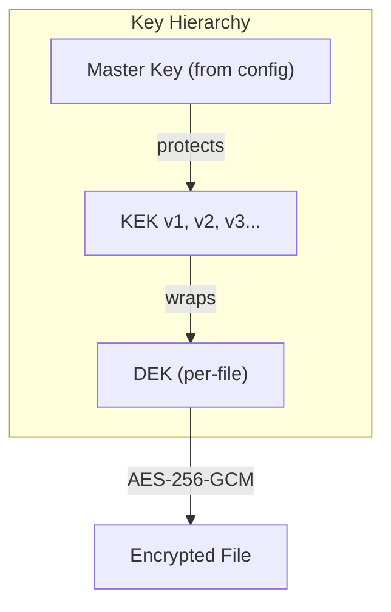

# Phase 10: KMS with Envelope Encryption & Automated Key Rotation

## Architecture Overview

## Components to Build

### 1. Database Schema (`database/schema_kms.sql`)
- `kek_versions` — versioned KEK store (id, version, encrypted_kek, nonce, salt, status, created_at, rotated_at, expires_at, compromise_at)
- `dek_registry` — per-file DEK wrapped by a specific KEK version (id, file_id, wrapped_dek, nonce, kek_version_id, created_at, rewrapped_at)
- `kms_audit_log` — all KMS operations logged (rotation, rewrap, compromise, recovery)
- `rotation_policies` — configurable rotation intervals per key type

### 2. Crypto Module (`crypto/kms.py`)
- KEK generation, encryption (protected by master key via HKDF + AES-256-GCM)
- DEK generation and wrapping/unwrapping using KEK
- Key versioning logic
- Envelope encrypt/decrypt functions

### 3. KMS Service (`models/kms.py`)
- CRUD for KEK versions
- DEK registry management
- Rotation policy enforcement
- Automated rotation checks
- Key compromise workflow (mark KEK as compromised, force-rewrap all DEKs)
- Recovery workflow

### 4. API Routes (`routes/kms.py`)
- `GET /api/kms/status` — current key hierarchy status
- `POST /api/kms/rotate` — trigger KEK rotation (admin)
- `GET /api/kms/keys` — list KEK versions with lifecycle info (admin)
- `POST /api/kms/keys/<version>/compromise` — mark key as compromised (admin)
- `POST /api/kms/keys/<version>/recover` — recover from compromise (admin)
- `POST /api/kms/rewrap` — rewrap all DEKs under latest KEK (admin)
- `GET /api/kms/audit` — KMS audit log (admin)
- `GET /api/kms/policy` — current rotation policy
- `PUT /api/kms/policy` — update rotation policy (admin)

### 5. KMS Dashboard Template (`templates/kms_dashboard.html`)
- Visual key hierarchy
- Rotation status and history
- One-click rotation and rewrap
- Compromise/recovery controls
- Audit trail

### 6. Tests (`tests/test_kms.py`)
- KEK generation and protection
- DEK wrap/unwrap cycle
- Rotation with old key access
- Rewrapping verification
- Compromise and recovery workflows
- Policy enforcement

## Key Design Decisions
- Master key derived from `SECRET_KEY` + dedicated KMS salt via HKDF
- KEKs stored AES-256-GCM encrypted in DB (never plaintext)
- DEKs wrapped using AES-256-GCM keywrap (not RSA — KEKs are symmetric)
- Old KEK versions kept in `rotated` status for historical access
- Compromise marks KEK as `compromised` and triggers mass rewrap
- Rotation is non-disruptive: only new files use the new KEK; old files decrypt with their original KEK version
